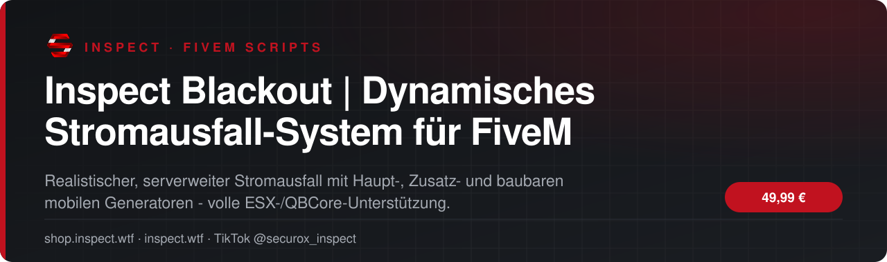
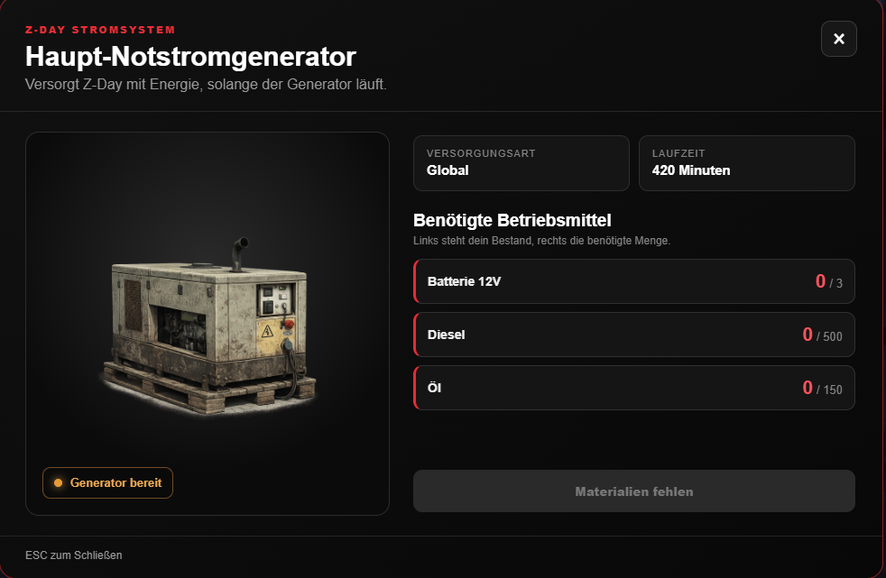
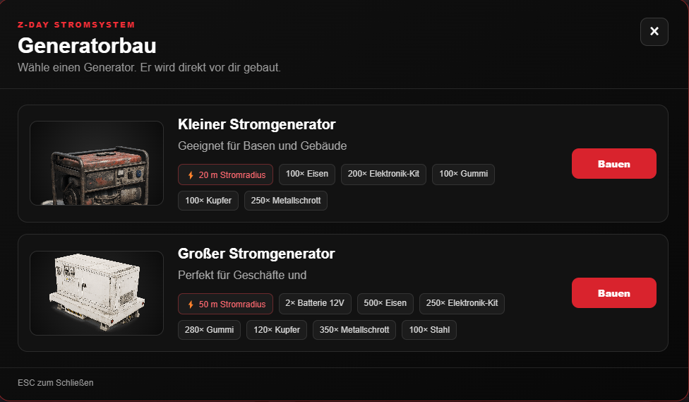
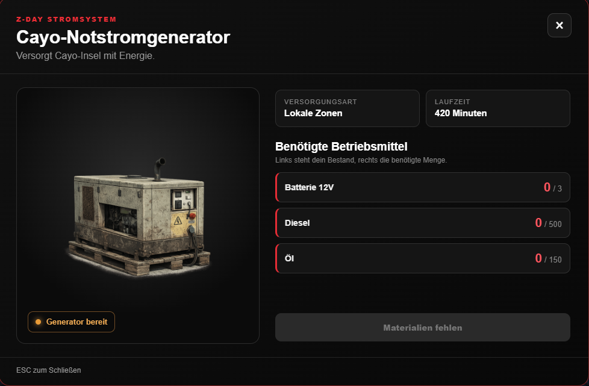

<!-- inspect-showcase: automatisch erzeugt, Änderungen bitte im Shop vornehmen -->

<h3>Realistischer, serverweiter Stromausfall mit Haupt-, Zusatz- und baubaren mobilen Generatoren - volle ESX-/QBCore-Unterstützung.</h3>

  
  
  
  
  

  
  
  

 

 

## Das Wichtigste auf einen Blick

<table>
  <tr>
    <td width="50%" valign="top">✔&nbsp; <b>Serverweiter Blackout-Modus</b></td>
    <td width="50%" valign="top">✔&nbsp; <b>Robuste Native-Fallbacks für unterschiedliche Server-Builds</b></td>
  </tr>
  <tr>
    <td width="50%" valign="top">✔&nbsp; <b>Beliebig viele Stromzonen als Kreis, Box oder Polygon - mit Höhenbegrenzung (minZ/maxZ)</b></td>
    <td width="50%" valign="top">✔&nbsp; <b>Fester Haupt-Generator (global) mit Blip, Item-Kosten, Laufzeit und ox_lib-NUI</b></td>
  </tr>
</table>

## Überblick

Inspect Blackout verwandelt euren Server in eine dunkle, stromlose Welt: Straßenlaternen, Ampeln, Interieur- und Fahrzeugbeleuchtung werden serverweit deaktiviert, bis Spieler die Stromversorgung eigenhändig wiederherstellen. Über einen festen Haupt-Generator lässt sich der globale Strom für alle konfigurierten Zonen aktivieren, ein zweiter, unabhängiger Zusatz-Generator versorgt ausschließlich sein eigenes Zonen-Set - ideal für einzelne Inseln oder Gebiete. Zusätzlich können Spieler an einem konfigurierbaren Crafting-Punkt kleine und große mobile Generatoren bauen, frei in der Welt platzieren und per Treibstoff eine eigene Stromzone mit individuellem Radius aktivieren. Alle Zonen lassen sich als Kreis, Box oder frei definiertes Polygon mit Höhenbegrenzung anlegen. Durch die integrierte Framework-Bridge läuft das Skript automatisch mit ESX oder QBCore sowie optional ox_inventory - konfigurierbar über eine einzige, klar beschriftete Einstellung in der config.lua. Admins steuern den Blackout jederzeit per Chat-Command oder ACE-Permission, ein optionaler Discord-Webhook protokolliert alle Generator-Aktivierungen.

## Kompatibilität

| | |
|:--|:--|
| Frameworks | **ESX** · **QBCore** |
| Unterstützte Ressourcen | `ox_inventory` |
| Plattform | FiveM (GTA V) |

## Alle weiteren Funktionen

- Unabhängiger Zusatz-Generator (lokal) mit eigenem, separatem Zonen-Set
- Baubare, mobile Generatoren (klein/groß) mit frei platzierbarem Prop und eigenem Stromradius
- Mobile Generatoren bleiben bis zum nächsten Ressourcen-Neustart aktiv
- Konfigurierbarer Crafting-Punkt mit eigenem Blip für die Generatoren-Herstellung
- Live-Item-Anzeige im NUI (vorhanden/benötigt) für alle drei Generator-Typen
- Framework-Bridge für ESX und QBCore (automatische Erkennung oder fest wählbar)
- ox_inventory-Unterstützung (automatisch erkannt und bevorzugt genutzt)
- Admin-Steuerung per Chat-Command (/strom an|aus, /stromzonen an|aus, blackout_toggle)
- ACE-Permission-System plus konfigurierbare Framework-Admin-Gruppen
- Export & Events zur Integration mit Basebuilding-/Recipe-Systemen (automatisches Abschalten der Stromzone beim Abbau)

<b>3 weitere Funktionen anzeigen</b>

- Optionaler Discord-Webhook für Generator-Start/-Stopp (standardmäßig deaktiviert, eigener Link erforderlich)
- Alle wichtigen Einstellungen zentral und beschriftet in der config.lua
- Übersichtliches, einheitliches ox_lib-NUI-Menü für alle Generator-Typen

## Einblicke

<table>
  <tr>
    <td width="50%"></td>
    <td width="50%"></td>
  </tr>
</table>

## Preis

**49,99 €** &nbsp;–&nbsp; einmaliger Kaufpreis · Download und Lizenz im Kundenkonto

Sichere Zahlung mit PayPal oder Kreditkarte · Rechnung als PDF · Support auf Deutsch

## So einfach geht's

1. **Im Shop kaufen** – sicher bezahlen mit PayPal oder Kreditkarte.
2. **Sofort loslegen** – Download und Lizenz stehen direkt nach Zahlungseingang in deinem Kundenkonto bereit, die Rechnung erhältst du als PDF.
3. **Einrichten** – bei Fragen hilft dir unser Support im Discord weiter.

## Warum INSPECT?

<table>
  <tr>
    <td width="50%" valign="top"><b>🇩🇪 Entwickelt in Deutschland</b> Konzeption, Entwicklung und Support aus einer Hand.</td>
    <td width="50%" valign="top"><b>💬 Persönlicher Support</b> Schnelle Hilfe auf Deutsch im INSPECT Discord.</td>
  </tr>
  <tr>
    <td width="50%" valign="top"><b>🔒 Sichere Zahlung</b> PayPal oder Kreditkarte, Rechnung automatisch als PDF.</td>
    <td width="50%" valign="top"><b>⚡ Sofort verfügbar</b> Download und Lizenz direkt nach der Zahlung im Kundenkonto.</td>
  </tr>
</table>

## Häufige Fragen

<b>Wie erhalte ich das Produkt?</b>

 

Nach bestätigter Zahlung stehen Download und Lizenz in deinem Kundenkonto bereit. Die Rechnung erhältst du als PDF.

<b>Welche Frameworks werden unterstützt?</b>

 

ESX, QBCore – zusätzlich mit Unterstützung für ox_inventory.

<b>Bekomme ich Hilfe bei der Einrichtung?</b>

 

Ja – unser Support hilft dir im [INSPECT Discord](https://discord.gg/inspect) persönlich und auf Deutsch.

<b>Wo kaufe ich offiziell?</b>

 

Ausschließlich im INSPECT Shop unter [shop.inspect.wtf](https://shop.inspect.wtf). Angebote von Dritten stammen nicht von uns.

## Kontakt

| | |
|:--|:--|
| 🛒 Shop | [shop.inspect.wtf](https://shop.inspect.wtf) |
| 🌐 Website | [inspect.wtf](https://inspect.wtf) |
| 💬 Discord | [discord.gg/inspect](https://discord.gg/inspect) |
| 🎬 TikTok | [@securox_inspect](https://www.tiktok.com/@securox_inspect) |
| ✉️ E-Mail | [info@inspect.wtf](mailto:info@inspect.wtf) |

---

<b>SecuroX Inspect</b> · Offizielle Produktpräsentation · Dieses Repository enthält keinen Quellcode und keine Produktdateien. 
Kauf und Lizenzen ausschließlich über <a href="https://shop.inspect.wtf">shop.inspect.wtf</a> · Inhalte werden automatisch aus dem Shop aktualisiert.

